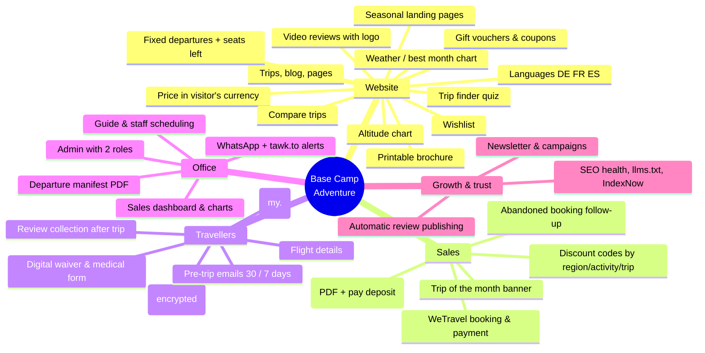

# Base Camp Adventure: upgrade roadmap

What's built, what's being built now, and ideas to discuss with the client.
Ask Claude to "check the roadmap" to pick up where we left off.

## Done

| Area | What |
| --- | --- |
| Admin | Content editors, media library, versions, hide/show/delete, ordering, homepage text, two roles, 2FA, mobile |
| Sales | WeTravel checkout and webhook, discount codes (all / regions / activities / trips), bookings, enquiries |
| Email | Branded templates, newsletter design, gift vouchers with QR code |
| Settings | Company details, social links, encrypted keys, tawk.to, GA4 |
| SEO | Titles/descriptions fixed, real 404s, llms.txt, IndexNow, all checks passing |
| Security | OWASP checks 19/19 (brute force, CSRF, XSS, injection, headers…) |

## In progress (approved)

- [x] Feature switches page (turn every feature on/off from the admin)
- [x] Abandoned booking follow-up (reminder if not paid after 24 h)
- [x] WhatsApp alerts to the office + booking/enquiry details in tawk.to chat
- [x] Review collection after the trip, moderated, shown on trip pages
- [x] Traveller portal on my.basecampadventure.com (secure login, documents, payments)
- [x] Languages: German, French, Spanish (system done; Everest Base Camp translated; 19 more trips to translate)

## Ideas to discuss with the client

| # | Feature | Why it helps | Size |
| --- | --- | --- | --- |
| 1 | Fixed departure dates with seats left | Strongest booking trigger; dates can show in Google | Medium |
| 2 | Price in the visitor's currency | Less hesitation for EU/UK/AU travellers | Small |
| 3 | Trip finder quiz | Guides first-time visitors to the right trip | Small |
| 4 | Compare trips side by side | Helps undecided travellers choose | Small |
| 5 | Pre-trip emails (30 / 7 days before) | Packing list, visa, airport pickup sent automatically | Small |
| 6 | Digital waiver & medical form | No paper forms in Kathmandu | Small |
| 7 | Sales dashboard with charts | Bookings, revenue, top trips, sources | Medium |
| 8 | Departure manifest PDF | Rooms, diets, guides per departure for the field team | Medium |
| 9 | Guide & staff scheduling | Who leads which departure, who is free | Medium |
| 10 | Quote builder | Tailor-made quote as branded PDF with "pay deposit" | Medium |
| 11 | Seasonal landing pages (e.g. "EBC in October") | Ranks for month searches | Small |
| 12 | Wishlist / save a trip + reminder | Brings visitors back | Small |
| 13 | Trip of the month banner | Promote a trip from the admin | Small |
| 14 | Weather & best-month chart per trip | Answers the #1 question | Small |
| 15 | Printable trip brochure | Shareable PDF with photos and altitude chart | Small |
| 16 | More languages (Chinese, Japanese, Hindi…) | New markets, once DE/FR/ES prove out | Medium |
